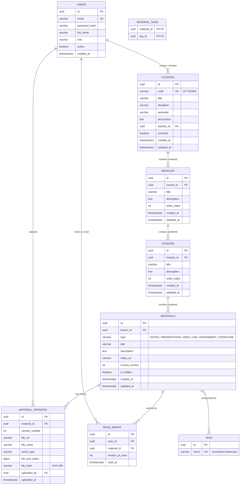

# DATA_MODEL – UniCloud, Екип 2

**Статус:** Одобрен модел за разработка (Седмица 1, UC-27)  
**Отговорници:** Златин Златинов (SE 1 – Backend & Data), Стилиян Тодоричков (SE 3 – Оптимизации и интеграции)  
**Технологии:** PostgreSQL 16+, Spring Data JPA, Hibernate, Flyway, Java 21  

---

## 1. Архитектурен преглед и ER Диаграма

Системата „Учебни материали и Медия“ е проектирана за **екстремно високо съотношение четене-към-запис (read-heavy)**, пиково натоварване в първите 5 минути на всяко занятие (08:15, 10:15, 14:15) и нулев бюджет (работа върху безплатни облачни инстанции с ограничени процесорни и паметови ресурси).

### Основни архитектурни принципи на модела:
1. **Йерархична структура на учебното съдържание:**  
   `Курс (Course)` → `Модул/Седмица (Module)` → `Занятие (Lesson)` → `Материал (Material)` → `Версия (MaterialVersion)`.
2. **Пълно версиониране на съдържанието:**  
   Всяка редакция или качване на обновен файл запазва предишната версия с нейната история и метаданни (автор, размер, дата, чексума).
3. **Изолация и защита на прогреса (ReadMark):**  
   Отметките за прочетени/прегледани материали са строго обвързани със студента и защитени срещу IDOR и дублиране.
4. **Оптимизация за бърз отговор при нулев бюджет:**  
   Използване на естествени типове на PostgreSQL (UUID, TIMESTAMPTZ, GIN Trigram), предварително подготвени индекси върху външните ключове и покриващи индекси за каталог и търсене.

### ER Диаграма



---

## 2. Детайлен модел на таблиците и релациите

Всички таблици използват **UUID v4** за първични ключове, осигурявайки съвместимост с `API_CONTRACTS.md` и разпределените системи (Екипи 1, 3, 4). Всички клеймове за време се съхраняват в **UTC (`TIMESTAMPTZ`)**.

### 2.1. Таблица `users`
Съхранява демо потребителите за Седмица 1 (UC-30) с роли и хеширани пароли. Форматът на идентификатора е съвместим с `sub` от JWT токена на Екип 1.

| Колона | Тип | Ограничения | Описание |
| --- | --- | --- | --- |
| `id` | `UUID` | `PRIMARY KEY DEFAULT gen_random_uuid()` | Уникален идентификатор |
| `email` | `VARCHAR(100)` | `NOT NULL, UNIQUE` | Потребителски имейл / вход |
| `password_hash` | `VARCHAR(255)` | `NOT NULL` | Хеширана парола (BCrypt) |
| `full_name` | `VARCHAR(150)` | `NOT NULL` | Име и фамилия |
| `role` | `VARCHAR(30)` | `NOT NULL, CHECK (role IN ('STUDENT', 'TEACHER', 'ADMIN', 'SERVICE'))` | Роля в системата |
| `active` | `BOOLEAN` | `NOT NULL DEFAULT true` | Статус на профила |
| `created_at` | `TIMESTAMPTZ` | `NOT NULL DEFAULT clock_timestamp()` | Дата на създаване |

- **Индекси:**  
  - `uk_users_email` (UNIQUE B-tree) върху `email`

---

### 2.2. Таблица `courses`
Представлява учебен курс. Бизнес идентификаторът `code` спазва формата `<ДИСЦИПЛИНА>-<ГОДИНА><СЕМЕСТЪР>` (напр. `OIT-2026W`).

| Колона | Тип | Ограничения | Описание |
| --- | --- | --- | --- |
| `id` | `UUID` | `PRIMARY KEY DEFAULT gen_random_uuid()` | Първичен ключ |
| `code` | `VARCHAR(30)` | `NOT NULL, UNIQUE` | Код на курс (напр. `OIT-2026W`) |
| `title` | `VARCHAR(200)` | `NOT NULL` | Име на курса |
| `discipline` | `VARCHAR(100)` | `NOT NULL` | Дисциплина / направление |
| `semester` | `VARCHAR(20)` | `NOT NULL` | Семестър (напр. `2026W`, `2026S`) |
| `description` | `TEXT` | `NULL` | Описание на курса и изисквания |
| `teacher_id` | `UUID` | `NOT NULL, REFERENCES users(id) ON DELETE RESTRICT` | Преподавател / титуляр |
| `archived` | `BOOLEAN` | `NOT NULL DEFAULT false` | Флаг за архив |
| `created_at` | `TIMESTAMPTZ` | `NOT NULL DEFAULT clock_timestamp()` | Време на създаване |
| `updated_at` | `TIMESTAMPTZ` | `NOT NULL DEFAULT clock_timestamp()` | Време на последна промяна |

- **Релации:**  
  - `users (1) -> courses (N)`: Връзка преподавател към курс. `ON DELETE RESTRICT` предотвратява изтриване на преподавател с активни курсове.
- **Индекси:**  
  - `uk_courses_code` (UNIQUE B-tree) върху `code`
  - `idx_courses_teacher_id` (B-tree) върху `teacher_id`
  - `idx_courses_discipline_semester` (B-tree) върху `(discipline, semester)`

---

### 2.3. Таблица `modules`
Организационна единица в курса (учебна седмица или тематичен модул).

| Колона | Тип | Ограничения | Описание |
| --- | --- | --- | --- |
| `id` | `UUID` | `PRIMARY KEY DEFAULT gen_random_uuid()` | Първичен ключ |
| `course_id` | `UUID` | `NOT NULL, REFERENCES courses(id) ON DELETE CASCADE` | Връзка към курс |
| `title` | `VARCHAR(200)` | `NOT NULL` | Заглавие на модула/седмицата |
| `description` | `TEXT` | `NULL` | Кратко описание |
| `order_index` | `INT` | `NOT NULL DEFAULT 0` | Позиция за сортиране |
| `created_at` | `TIMESTAMPTZ` | `NOT NULL DEFAULT clock_timestamp()` | Време на създаване |
| `updated_at` | `TIMESTAMPTZ` | `NOT NULL DEFAULT clock_timestamp()` | Време на промяна |

- **Релации:**  
  - `courses (1) -> modules (N)`: При изтриване на курс се изтриват и модулите му (`CASCADE`).
- **Индекси:**  
  - `idx_modules_course_order` (B-tree) върху `(course_id, order_index ASC)`

---

### 2.4. Таблица `lessons`
Конкретно учебно занятие (лекция, упражнение, семинар) в модула.

| Колона | Тип | Ограничения | Описание |
| --- | --- | --- | --- |
| `id` | `UUID` | `PRIMARY KEY DEFAULT gen_random_uuid()` | Първичен ключ |
| `module_id` | `UUID` | `NOT NULL, REFERENCES modules(id) ON DELETE CASCADE` | Връзка към модул |
| `title` | `VARCHAR(200)` | `NOT NULL` | Заглавие на занятието |
| `description` | `TEXT` | `NULL` | Теми и конспект за занятието |
| `order_index` | `INT` | `NOT NULL DEFAULT 0` | Позиция в модула |
| `created_at` | `TIMESTAMPTZ` | `NOT NULL DEFAULT clock_timestamp()` | Време на създаване |
| `updated_at` | `TIMESTAMPTZ` | `NOT NULL DEFAULT clock_timestamp()` | Време на промяна |

- **Релации:**  
  - `modules (1) -> lessons (N)`: `ON DELETE CASCADE`.
- **Индекси:**  
  - `idx_lessons_module_order` (B-tree) върху `(module_id, order_index ASC)`

---

### 2.5. Таблица `materials`
Описва учебен материал. Видео лекциите се съхраняват като външни препратки (`video_url`), а презентациите и документите имат версии в `material_versions`.

| Колона | Тип | Ограничения | Описание |
| --- | --- | --- | --- |
| `id` | `UUID` | `PRIMARY KEY DEFAULT gen_random_uuid()` | Първичен ключ |
| `lesson_id` | `UUID` | `NOT NULL, REFERENCES lessons(id) ON DELETE CASCADE` | Връзка към занятие |
| `type` | `VARCHAR(30)` | `NOT NULL, CHECK (type IN ('NOTES', 'PRESENTATION', 'VIDEO_LINK', 'ASSIGNMENT', 'LITERATURE'))` | Категория на материала |
| `title` | `VARCHAR(255)` | `NOT NULL` | Заглавие на материала |
| `description` | `TEXT` | `NULL` | Описание / указания |
| `video_url` | `VARCHAR(1000)` | `NULL` | URL за видео (при тип `VIDEO_LINK`) |
| `current_version` | `INT` | `NOT NULL DEFAULT 1` | Номер на актуалната версия |
| `is_hidden` | `BOOLEAN` | `NOT NULL DEFAULT false` | Скрит ли е за студенти (US-05) |
| `created_at` | `TIMESTAMPTZ` | `NOT NULL DEFAULT clock_timestamp()` | Време на създаване |
| `updated_at` | `TIMESTAMPTZ` | `NOT NULL DEFAULT clock_timestamp()` | Време на промяна |

- **Релации:**  
  - `lessons (1) -> materials (N)`: `ON DELETE CASCADE`.
- **Индекси:**  
  - `idx_materials_lesson_hidden` (B-tree) върху `(lesson_id, is_hidden)` — ключов индекс при показване на съдържание за студенти.
  - `idx_materials_type` (B-tree) върху `type` — филтриране по вид (напр. само задачи за Екип 3).

---

### 2.6. Таблица `material_versions`
Съхранява физическите файлове и тяхната хронология (US-04, UC-29). При качване на нов файл се увеличава номерът на версията, без да се трие старата.

| Колона | Тип | Ограничения | Описание |
| --- | --- | --- | --- |
| `id` | `UUID` | `PRIMARY KEY DEFAULT gen_random_uuid()` | Първичен ключ |
| `material_id` | `UUID` | `NOT NULL, REFERENCES materials(id) ON DELETE CASCADE` | Връзка към материал |
| `version_number` | `INT` | `NOT NULL` | Пореден номер на версия (1, 2, ...) |
| `file_url` | `VARCHAR(1000)` | `NOT NULL` | Адрес на файла в обектното хранилище |
| `file_name` | `VARCHAR(255)` | `NOT NULL` | Оригинално име на файла |
| `mime_type` | `VARCHAR(100)` | `NOT NULL` | MIME тип (напр. `application/pdf`) |
| `file_size_bytes` | `BIGINT` | `NOT NULL` | Размер в байтове (до 50 MB) |
| `file_hash` | `VARCHAR(64)` | `NULL` | SHA-256 хеш за цялост и сигурност |
| `uploaded_by` | `UUID` | `NOT NULL, REFERENCES users(id)` | Потребител, качил версията |
| `uploaded_at` | `TIMESTAMPTZ` | `NOT NULL DEFAULT clock_timestamp()` | Дата и час на качване |

- **Релации:**  
  - `materials (1) -> material_versions (N)`: `ON DELETE CASCADE`.
  - `users (1) -> material_versions (N)`: Автор на файла.
- **Ограничения и Индекси:**  
  - `uk_material_version` (UNIQUE B-tree) върху `(material_id, version_number)`
  - `idx_material_versions_lookup` (B-tree) върху `(material_id, version_number DESC)`

---

### 2.7. Таблици `tags` и `material_tags`
Позволяват класификация и филтриране на материали чрез тагове (M:N връзка).

#### `tags`
| Колона | Тип | Ограничения | Описание |
| --- | --- | --- | --- |
| `id` | `UUID` | `PRIMARY KEY DEFAULT gen_random_uuid()` | Първичен ключ |
| `name` | `VARCHAR(50)` | `NOT NULL, UNIQUE` | Нормализиран таг (lowercase, trimmed) |

#### `material_tags` (Join Table)
| Колона | Тип | Ограничения | Описание |
| --- | --- | --- | --- |
| `material_id` | `UUID` | `NOT NULL, REFERENCES materials(id) ON DELETE CASCADE` | Материал |
| `tag_id` | `UUID` | `NOT NULL, REFERENCES tags(id) ON DELETE CASCADE` | Таг |

- **Първичен ключ и Индекси:**  
  - `PRIMARY KEY (material_id, tag_id)`
  - `idx_material_tags_tag_id` (B-tree) върху `tag_id`

---

### 2.8. Таблица `read_marks`
Служи за отбелязване на прочетено/прегледано съдържание от студентите (US-09, UC-41). Предотвратява дубликати и гарантира бърза проверка на личния прогрес в курс.

| Колона | Тип | Ограничения | Описание |
| --- | --- | --- | --- |
| `id` | `UUID` | `PRIMARY KEY DEFAULT gen_random_uuid()` | Първичен ключ |
| `user_id` | `UUID` | `NOT NULL, REFERENCES users(id) ON DELETE CASCADE` | Студент |
| `material_id` | `UUID` | `NOT NULL, REFERENCES materials(id) ON DELETE CASCADE` | Прочетен материал |
| `version_at_read` | `INT` | `NOT NULL DEFAULT 1` | Версия на материала при прочитане |
| `read_at` | `TIMESTAMPTZ` | `NOT NULL DEFAULT clock_timestamp()` | Дата и час на прочитане |

- **Ограничения и Индекси:**  
  - `uk_user_material_read` (UNIQUE B-tree) върху `(user_id, material_id)` — гарантира, че студент има най-много един запис за даден материал.
  - `idx_read_marks_user_id` (B-tree) върху `user_id` — мигновено зареждане на списъка с прочетени материали за текущия студент.

---

## 3. Оптимизация за пикови натоварвания и търсене (UC-31, UC-42)

В началото на всяка лекция (08:15 ч.) хиляди студенти правят паралелни заявки за отваряне на курса и търсене на материали. Тъй като инфраструктурата работи на безплатни облачни инстанции, базата данни е конфигурирана за максимална ефективност без тежки изчисления при четене:

### 3.1. Разширение `pg_trgm` за Fuzzy търсене на кирилица
За да изпълни изискването от UC-31 (търсене на кирилица с толеранс към 1 сбъркана буква и p95 отговор < 500 ms), в схемата се активира разширението:
```sql
CREATE EXTENSION IF NOT EXISTS pg_trgm;
```

### 3.2. GIN Trigram индекси
Пълнотекстовото търсене през `LIKE '%...%'` или regex предизвиква пълно сканиране на таблицата (Full Table Scan). За избягването му се създават GIN Trigram индекси:
```sql
-- Търсене в материали по заглавие и описание:
CREATE INDEX idx_materials_title_trgm ON materials USING gin (title gin_trgm_ops);
CREATE INDEX idx_materials_description_trgm ON materials USING gin (description gin_trgm_ops);

-- Търсене в курсове по заглавие и дисциплина:
CREATE INDEX idx_courses_title_trgm ON courses USING gin (title gin_trgm_ops);
CREATE INDEX idx_courses_discipline_trgm ON courses USING gin (discipline gin_trgm_ops);

-- Търсене по тагове:
CREATE INDEX idx_tags_name_trgm ON tags USING gin (name gin_trgm_ops);
```

### 3.3. Индекси за покриване на пиковите операции
1. **Каталог и зареждане на курс (`GET /courses/{id}`):**  
   Заявката събира структурата `course -> modules -> lessons -> materials`. Всички външни ключове имат директни B-tree индекси с подреждане (`order_index ASC`), което елиминира `filesort` операциите в PostgreSQL.
2. **Проверка на личния прогрес (`GET /courses/{id}/progress`):**  
   Индексът `uk_user_material_read` върху `(user_id, material_id)` и индексът `idx_read_marks_user_id` гарантират, че заявката филтрира материалите само с индексиран `Index Scan` / `Bitmap Index Scan`.
3. **Филтриране на скрити материали за студенти:**  
   Композитният индекс `idx_materials_lesson_hidden (lesson_id, is_hidden)` гарантира бързо филтриране без преглеждане на скрити чернови.

### 3.4. Ограничаване на блокировките (Lock Contention)
- При запис на отметка за прочетено (`PUT /materials/{id}/read`) се използва идемпотентна операция:
  `INSERT INTO read_marks ... ON CONFLICT (user_id, material_id) DO UPDATE SET read_at = EXCLUDED.read_at, version_at_read = EXCLUDED.version_at_read;`
  Това предпазва връзките към базата данни от изключения и транзакционни откази при дублирани кликове от потребителите.

